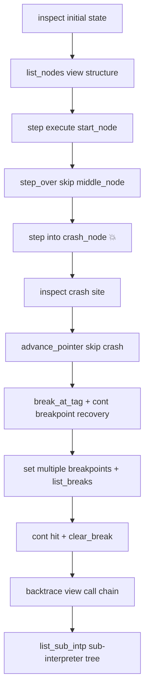

# REPL Debugging

AmritaSense provides a dedicated debugger module `amrita_sense.debugger` — a pure-function, REPL-first debugging toolkit. It leverages the interpreter's built-in Panic/Recover mechanism, middleware injection, and step-by-step execution to let you debug workflows in a Python REPL just like local programs — no extra tools, no IDE plugins required.

> **Prerequisites**
> We recommend reading [Execution & Interrupt](/guide/concepts/exec_and_interrupt) for step-by-step execution and suspension mechanisms, and [External Interrupt](/guide/advanced/external_interrupt) for the `call_sub(interrupt=True)` principle. This article builds on that infrastructure to deliver a complete debugging experience.

## Design Philosophy

The debugger follows three core principles:

1. **REPL-first** — All functions are synchronous (`step(inter)`, no `await`), callable directly in `python`, `ipython`, or VS Code's native REPL
2. **Pure-function** — No wrapper classes, no state encapsulation. Each function takes a `WorkflowInterpreter` as its first argument: `from amrita_sense.debugger import *`
3. **Non-invasive** — Breakpoints are injected via composite middleware, never modifying the core runtime. Debug code does not couple with business logic

```python
>>> from amrita_sense.debugger import *
>>> inspect(inter)       # view state
>>> step(inter)          # execute one node
>>> break_at_tag(inter, "my_node")
>>> cont(inter)          # continue to breakpoint
```

## State Inspection

The first step of debugging is always "know where you are." The debugger provides a complete set of state inspection tools.

### `where(inter)` — Current Location

A one-line summary to quickly confirm where execution is paused:

```
📍 [0, 2]  crash_here  stack_depth=0
```

Displays: current address, node tag, return-address stack depth.

### `inspect(inter)` — Full State

Pretty-prints all interpreter internal state:

- 🆔 Interpreter ID, parent & root
- 📍 Current pointer position and node info (tag, function name)
- 🏃 Running status and pending-stop flag
- 📚 Return address stack (depth + full contents)
- 📦 Context stack (depth + each context's pointer & exception)
- ⚠️ Panic exception (if crashed)
- 👶 Sub-interpreter tree (status & pointer for each child)

```python
>>> inspect(inter)
══════════════════════════════════════════════════════════
🆔  Interpreter: a1b2c3d4e5f6…
📍 Pointer:      [0, 2]
🔍 Node:         crash_here
   Function:     crash_node
🏃 Running:      no
🚩 Pending stop: no
📚 Return stack: depth=0
📦 Context stack: depth=0
⚠️  Panic:        RuntimeError: planned crash for demo
👶 Sub-interpreters: 0
══════════════════════════════════════════════════════════
```

### `backtrace(inter)` — Call Chain

Expands the full call chain: interpreter tree (Root → … → Current), return address stack, context stack, and current node.

```python
>>> backtrace(inter)
Interpreter → a1b2c3d4e5f6… [Root] [Current] at 0x7f8a1c00d000

Returning Stack:
    0. [0, 2] (Current)

Context Stack:
    (EMPTY_STACK)

Current node: crash_here -> crash_node
```

### `list_nodes(inter)` — Node Listing

Traverses the compiled graph's `_graph` tree, printing every node's address, tag, and function name. Like stdlib's `dis.dis()`, useful for understanding the overall workflow structure:

```
   [0, 0]  start             start_node
   [0, 1]  middle            middle_node
   [0, 2]  crash_here        crash_node
   [0, 3]  never_reached     never_reached
```

For a segment-oriented view that also shows mnemonics and the current program counter, use [`dis()`](#disassembly-view) instead.

### `list_sub_intp(inter)` — Sub-interpreter Tree

Recursively expands the entire interpreter tree, showing each sub-interpreter's running status, current pointer, and exception:

```
🟢 a1b2c3...  ptr=[0, 1]
  ⏸️ d4e5f6...  ptr=[0, 1]  exc=RuntimeError
  🟢 g7h8i9...  ptr=[1, 2]
```

## Disassembly View

A rendered workflow graph _is_ an address-mapped instruction sequence — `[1, 0]` is an address and the pointer vector is the program counter. `dis()` renders it the way GDB renders machine code, with segments instead of indentation:

```
segment [root]:
=>[0] (top) ALIAS top; alias for Alpha
  [1]       INVOKE top -> [0]; InvokeNode
  [2]       *segment [2]
  [3]       JMP [0]; JMP 'top'
  [4]       NOP; no operation

segment [2]:
  [2, 0] JMPIF; ConditionJumpNode
  [2, 1] Cond; Cond
  [2, 2] Beta; Beta
  [2, 3] NOP; no operation
```

- `=>` marks the program counter, exactly like GDB.
- A nested container appears in its parent as a `*segment [n]` reference line and gets its own block, so deep graphs stay flat instead of growing an indentation tree.
- `;` separates the mnemonic from the comment. A `(name)` next to an address is an `ALIAS`-registered symbol.
- A container that is not the default rendered graph shows its class, e.g. `segment [1] <DLLComposeProxy>:` — a reminder that everything below a DLL slot moves when `dll.apply()` rebases it.

### `dis(inter, *, around=5)` — Print the Listing

`dis()` prints a window of instructions around the program counter. Pass `around=None` for the whole graph, or use `disassemble()` to get the same text as a string:

```python
>>> dis(inter)                 # 5 lines before/after the PC
>>> dis(inter, around=None)    # the entire workflow
>>> text = disassemble(inter)  # same content, as a str
```

`step()` / `step_over()` / `step_out()` / `cont()` print the listing automatically, so every stop shows where you are:

```
>>> step(inter)
segment [1]:
  [1, 0] Beta; Beta
=>[1, 1] Gamma; Gamma
```

`step_over()` and `step_out()` print only once, when the whole movement finishes. Set `amrita_sense.debugger.code_disp.AUTO_DIS = False` to silence the automatic printing while keeping `dis()` available.

### Colour

The listing is colourised through [colorama](https://pypi.org/project/colorama/) when stdout is a terminal: the `=>` marker is bold green, addresses cyan, aliases green, mnemonics bold, operands yellow, comments dim, and segment headers bold magenta. Piping the output to a file or a pager naturally yields plain text.

```python
>>> from amrita_sense.debugger import code_disp
>>> code_disp.COLOR = True    # force on, even when piped
>>> code_disp.COLOR = False   # force off
>>> code_disp.COLOR = None    # auto-detect (default)
```

Colour is applied _after_ column padding, so enabling it never shifts the instruction column. Every palette entry is a module constant (`code_disp.C_PC`, `C_ADDR`, `C_MNEMONIC`, `C_OPERAND`, …), so a theme is just a matter of reassigning them.

### Magic attributes: `__sdb_dis__` and `__sdb_cmt__`

The mnemonic comes from a **soft-constraint magic attribute** on the node, so an instruction can describe itself:

| Attribute     | Effect                                                                      |
| ------------- | --------------------------------------------------------------------------- |
| `__sdb_dis__` | The text in the instruction column.                                         |
| `__sdb_cmt__` | When not `None`, overrides the comment after `;` (which defaults to `tag`). |

Both are read through a plain `getattr` at disassembly time — the input is an _already compiled_ graph, so an operand such as a jump target is resolved by then. All three declaration forms work:

| Form                   | Use it for                                                                                                              |
| ---------------------- | ----------------------------------------------------------------------------------------------------------------------- |
| **class attribute**    | a fixed mnemonic shared by every instance.                                                                              |
| **`@property`**        | a value derived from instance state — it re-reads on every listing, so nothing has to be re-assigned after a recompile. |
| **instance attribute** | factory-created instructions whose operand only exists inside a closure (`PUSH_RET`, `INT`, …).                         |

Neither name is subject to name mangling (two trailing underscores), so `self.__sdb_dis__ = ...` inside a class body is safe. A property is a _data descriptor_, though, so a node that declares one intentionally rejects `self.__sdb_dis__ = ...` — that is what keeps the value single-sourced.

```python
from amrita_sense.node.core import BaseNode, NodeComposeRendered


class MyJump(BaseNode):
    """Custom instruction that displays its resolved target."""

    __sdb_cmt__ = "custom jump"

    def __init__(self, alias: str) -> None:
        self._alias = alias
        self._target: list[int] = []
        self._init(self.__call__, tag=None, wrap_to_async=False, address_able=True)

    @property
    def __sdb_dis__(self) -> str:
        #  a property re-reads state, so this stays correct after every recompile
        return f"MYJMP {self._target or '?'}"

    def _post_compile(self, compose: NodeComposeRendered) -> None:
        self._target = compose.calc.resolve_alias(self._alias)
```

When a node declares nothing the view falls back to its `tag` — with a `__NAME__` decoration stripped, so `__RET__` shows as `RET` — or to the wrapped function name for auto-generated `NodeSuspend::…` tags.

### Operand notation

A node never knows its own address, so a target that is relative to the enclosing segment cannot be printed as a full address. Operands are written to match the pointer operation they come from:

| Notation    | Meaning                                   | Pointer operation |
| ----------- | ----------------------------------------- | ----------------- |
| `[1, 0]`    | an absolute address                       | `far_to`          |
| `#3`        | slot 3 **of the node's own segment**      | `near_to`         |
| `+2` / `-1` | a delta **inside the node's own segment** | `offset`          |

The built-in instruction set uses this throughout, so a listing of framework control flow reads like assembly:

```
segment [2]:
  [2, 0] JMPIF then=#3 else=+3; ConditionJumpNode
  [2, 1] Cond; Cond
  [2, 2] Beta; Beta
  [2, 3] NOP; no operation

segment [3]:
  [3, 0] WHILE checkup=#3 else=#4; WhileNode
  [3, 3] WHILE.CHECK back=#0; CheckUpNode

segment [4]:
  [4, 0] TRY catch=ValueError#2; finally=#3 escape=#4
```

Other built-in mnemonics you will see: `JMP [0]` (`JMP`), `INVOKE sym -> [0]`
(`INVOKE`), `CALL to, ret=from` (`CALL`), `PUSH [0]` (`PUSH_RET`), `RET` (`RET`),
`PUSHCTX` / `INT` / `IRET` (context and interrupt stack), `RESET` / `SUSPEND`
(termination), `DO loop=#3 break=#5`, `DO.CHECK back=#0 exit=#3`, and the native
fast-path set `NJMPIF` / `NWHILE` / `NDO.CHECK` / `NENTER`.

### Addressing modes and contract safety

The listing is built by walking the graph through the `AbstractCompose` **contract** rather than a concrete class, because a rendered graph may be a `DLLComposeProxy` or a custom implementation (see [Compose Contracts](../advanced/compose-contracts)). Two consequences are worth knowing:

- A container that refuses to be read — an unbuilt DLL proxy raises `NullPointerException` — is shown as an `(unreadable)` segment instead of aborting the listing.
- The symbol table (`alias2vector_map`) is _not_ part of the contract, so aliases are a soft feature: a graph without one degrades to plain addresses.

Because a DLL rebase makes absolute addresses unreliable (see [Dynamic Linking](../advanced/dll_feature)), prefer aliases when reading a listing — the alias column tells you which addresses are symbols.

## Step Control

Step control lets you precisely control execution one node at a time. Two API flavors are provided:

| Style     | Functions                                                            | Use Case                      |
| --------- | -------------------------------------------------------------------- | ----------------------------- |
| **Sync**  | `step()` `step_over()` `step_out()` `cont()`                         | Python REPL (no `await`)      |
| **Async** | `step_async()` `step_over_async()` `step_out_async()` `cont_async()` | Inside an existing event loop |

### `step(inter)` — Single Step

Executes **exactly one** node and stops. The fundamental primitive:

```python
>>> step(inter)
  [start] running…
>>> where(inter)
📍 [0, 1]  middle  stack_depth=0
```

Under the hood: `step()` sets the `stepping` flag to `True` during execution, so breakpoint checks are skipped — meaning single-step debugging won't trigger breakpoints.

Every step also prints the [disassembly view](#disassembly-view) at the new program counter, so you can see exactly which instruction you are about to execute.

### `step_over(inter)` — Step Over

Executes the node but **does not enter** subroutine calls (`call_sub` / `INVOKE`). Internally monitors `_ret_addr_stack` depth — as long as depth exceeds the starting value, execution continues until returning to the same stack frame.

```python
>>> step_over(inter)  # If current node calls call_sub,
                       # the subroutine still executes fully,
                       # but won't pause inside it
```

### `step_out(inter)` — Step Out

Executes until the return address stack becomes shallower — i.e., exits the current subroutine call frame:

```python
>>> step_out(inter)   # Execute layer by layer from deep inside
                       # a call_sub until returning to the caller
```

### `cont(inter)` — Continue

Continues execution until a breakpoint is hit or the workflow ends. Clears the `stepping` flag so breakpoint checks resume:

```python
>>> cont(inter)
⏸️  Hit breakpoint: tag='my_node' hits=1
```

A breakpoint stops execution **before** its node runs, so the next `cont()` executes that node and moves on:

```python
>>> cont(inter)   # runs everything up to 'my_node', stops before it
>>> cont(inter)   # 'my_node' runs, then continues to the next breakpoint
```

Only the address that was actually stopped on is skipped, so a second breakpoint further along still fires. Once a workflow has finished, the next `cont()` starts it over from the first instruction.

`cont()` also prints the [disassembly view](#disassembly-view) where it stops — either at the breakpoint or at the end of the workflow.

### Exception Handling

All step functions gracefully handle three predictable scenarios:

| Scenario                      | Behavior                                                   |
| ----------------------------- | ---------------------------------------------------------- |
| `BreakpointHit` raised        | Prints `⏸️  Hit breakpoint: ...`                           |
| `Ctrl+C` pressed              | Prints `⏸️  Stop at: [addr]`                               |
| Node throws exception (crash) | Prints `⚠️  Node crashed: ... Panic saved, use inspect().` |

After a crash, execution state is preserved — `_panic_exc`, `_pointer`, `_ret_addr_stack` all remain intact. Use `inspect()` to examine the full crash site.

## Breakpoint System

Breakpoints are injected via **composite middleware** into the interpreter. Core design:

```text
debug_middleware(pc):
    1. Check breakpoints → raise BreakpointHit if matched
    2. Call user's original middleware (if present)
    3. Otherwise call pc._call() directly
```

A hit means the node at the current address is _about to_ run — nothing has executed yet. The debugger remembers that address so the next `cont()` skips the check once and lets the node run; without that, the same breakpoint would fire again before the node ever got a chance to execute, and `cont()` could never progress. An explicit `step()` discards a pending resume, since stepping bypasses breakpoint checks anyway.

::: details Middleware injection details
When the first breakpoint is set, the debugger:

1. Saves `inter._middleware`'s current value (user's original middleware, if any)
2. Constructs composite middleware: `breakpoint check → user middleware → _call()`
3. Replaces `inter._middleware` with the composite

The user's original middleware is always respected; breakpoint checks are inserted as a prefix step. Clearing all breakpoints does **not** remove the composite middleware — recreate the interpreter if you need the original state restored.
:::

### `break_at_tag(inter, tag, *, condition=None)` — Set Breakpoint by Tag

Sets a breakpoint on **all** nodes whose `tag` matches. `tag` is the label specified in `@Node(tag="...")`:

```python
>>> break_at_tag(inter, "crash_here")
🔴 Breakpoint: tag='crash_here' hits=0
```

### `break_at_addr(inter, addr, *, condition=None)` — Set Breakpoint by Address

Sets a breakpoint at a precise address. `addr` can be:

- **Alias** (`str`): resolved via `AddressCalculator.resolve_alias()`
- **Raw address** (`list[int]`): e.g., `[0, 2]`

```python
>>> break_at_addr(inter, [0, 1])
🔴 Breakpoint: addr=[0, 1] hits=0

>>> break_at_addr(inter, "my_alias")
🔴 Breakpoint: addr=[2, 0] hits=0
```

### Conditional Breakpoints

The `condition` parameter accepts a `(WorkflowInterpreter) -> bool` callable:

```python
>>> break_at_tag(inter, "middle", condition=lambda pc: len(pc._ret_addr_stack) > 0)
🔴 Breakpoint: tag='middle' hits=0 cond
```

The breakpoint only triggers when the condition returns `True`. If the condition raises an exception, it silently skips (no trigger).

### Managing Breakpoints

```python
>>> list_breaks(inter)                  # List all breakpoints
  1. TAG  'crash_here'  hits=1
  2. ADDR  [0, 1]  hits=0

>>> clear_break_tag(inter, "crash_here")  # Clear by tag
✖  Removed: tag='crash_here' hits=1

>>> clear_break_addr(inter, [0, 1])       # Clear by address
✖  Removed: addr=[0, 1] hits=0
```

### `BreakpointHit` — Breakpoint Exception

`BreakpointHit` inherits from `BaseException` (not `Exception`), so it is **never** caught by the Panic/Recover mechanism and will not put the interpreter into a panic state.

```python
>>> bp = Breakpoint(target="test", kind="tag")
>>> isinstance(BreakpointHit(bp), BaseException)  # True
>>> isinstance(BreakpointHit(bp), Exception)      # False
```

## Crash Recovery

AmritaSense's Panic/Recover mechanism is one of the debugger's core capabilities. When a node throws an unhandled exception, the interpreter preserves its state.

### Typical Workflow

```python
# 1. Execute into the crashing node
>>> step(inter)
  [crash_here] about to explode 💥
⚠️  Node crashed: RuntimeError('planned crash for demo'). Panic saved, use inspect().

# 2. Examine the crash site
>>> inspect(inter)  # Shows full state: _panic_exc = RuntimeError,
                     # _pointer stuck at crash_here, stacks intact

# 3. Manually skip the crashing node
>>> inter.advance_pointer()

# 4. Set a breakpoint on the recovery target
>>> break_at_tag(inter, "never_reached")

# 5. Continue execution (internally recovers from panic)
>>> cont(inter)
  [never_reached] recovered successfully! 🎉
```

**Recovery principle**: `step()` / `cont()` internally calls `_step_one()`, which checks `_panic_exc` before each execution. If non-`None`, it clears it (recover), then normally executes the node at the current pointer. Since you've already manually `advance_pointer()` past the crash node, recovery executes the next node.

## Crash Rescue: `RESCUE_ON_PANIC`

### What it solves

A panic normally propagates straight out of `run()`: the `finally` block clears `_waiter_fut`, stores the exception in `_panic_exc`, and hands control back to the caller. The scene is actually still intact — pointer parked on the failing node, return stack untouched, context stack preserved — but by the time you get back to a prompt, all that is usually left is a traceback.

This flag keeps the few seconds before the re-raise for you.

### Enabling

```python
from amrita_sense._unsafe import __flags__

__flags__.RESCUE_ON_PANIC = True
```

It is an unsafe flag: togglable at runtime, but treat it as start-up configuration.

### Two paths

| Condition | Behaviour |
| --- | --- |
| stdin is an interactive terminal | Enter `(sdb)` in-process and block until `q`, `k` or EOF |
| No terminal (CI, bot process, pipe) | Raise immediately, attaching a `PanicReport` as `__sdb_report__` (plus `add_note` on 3.11+) |

The TTY probe is stricter than `isatty()`: the process must be in the terminal's foreground process group (a background process reading a tty is stopped by `SIGTTIN`, which looks exactly like a hang), and `TERM` must not be `dumb`. Two environment variables override the result:

```bash
SDB_REPL_DISABLE=1   # never enter (production guard, highest priority)
SDB_REPL_FORCE=1     # force the REPL (tests, manual probing)
SDB_REPL_TIMEOUT=300 # seconds without input before returning; 0 disables
```

`SDB_REPL_DISABLE` always beats `SDB_REPL_FORCE`: an environment that explicitly turned rescue off must not be re-opened by a leftover FORCE.

**Either way the exception type is never rewritten.** Rescue preserves the scene; it does not swallow the failure. `q` re-raises the original exception unchanged, so upstream `except RuntimeError` handlers keep working.

### Commands

| Command | Alias | Purpose |
| --- | --- | --- |
| `step [n]` | `s` | Execute n nodes (default 1) |
| `next` | `n` | Step over one node |
| `finish` | `fin` | Run to the end of the current frame |
| `cont` | `c` | Continue to a breakpoint or the end |
| `skip` | | Advance past the failing node without touching the stack |
| `until [addr]` | `u` | Step until past the current address (or to `addr`) |
| `jump [addr]` | `j` | Rewrite the program counter |
| `backtrace` | `bt` | Print the interpreter call chain |
| `info r\|b\|f\|l\|w` | `i` | Registers, breakpoints, interpreter tree, node list, current position |
| `examine [n]` | `x` | Disassemble around the current segment |
| `print <expr>` | `p` | Evaluate a restricted expression |
| `set $reg = <value>` | | Write a pseudo-register (addresses are validated) |
| `break tag:x` / `break *[1, 0]` | `b` | Set a breakpoint |
| `delete tag:x` / `*[1, 0]` / `all` | `d` | Delete breakpoints |
| `breaks` | `bl` | List breakpoints |
| `reset` | `rs` | Reset the interpreter (invalidates the snapshot) |
| `undo` | | Restore debugger state (pc / return stack / flags / panic) — no business rollback |
| `python [code]` | `py` | Embedded Python console |
| `quit` | `q` | Leave and re-raise the original panic |
| `kill` | `k` | Abandon the scene and close the workflow scope |
| `suppress [continue]` | `pass` | Swallow the panic: without an argument `run()` returns normally; with `continue` it advances past the failing node and finishes the rest first |
| `help [cmd]` | `h`, `?` | Help |

A blank line repeats the previous command; `#` comments to end of line. Tokens may be quoted, and full-width punctuation is folded to ASCII so a CJK IME cannot silently break a command.

Input lines are handled by GNU readline: cursor movement, history and tab completion all work. Completion offers command names, pseudo-registers, and real node tags after `tag:` (enumerated from the current graph and cached); inside `py`, tab completion switches to Python namespace names. History lives in `~/.sdb_history`; set `SDB_HISTORY` to relocate it.

Colour follows the output stream: the prompt, the `panic:` line, errors, success messages and the disassembly are styled on a terminal. `NO_COLOR` or `TERM=dumb` disables it; `FORCE_COLOR=1` forces it even through a pipe.

### Pseudo-registers

| Name | Meaning | Writable |
| --- | --- | --- |
| `$pc` | Current address vector, e.g. `[1, 0]`; empty once the workflow ends | Yes, after validation |
| `$rp` | Top of the return stack | No |
| `$flags` | Status register as an integer | Yes |
| `$exc` | The stored panic exception | Yes (exception instance or `None`) |

`set $pc = [2]` is equivalent to `jump [2]`. The validation exists for a reason: pointing the PC at a non-existent segment turns the next `cont` into an `IndexError`, which panics again and burns the nested-rescue budget for nothing.

### Resuming an interrupted run

Three options, from least to most invasive:

```text
(sdb) [1] explode> skip
pc -> [2]
`s` or `c` will now resume after the failed node
(sdb) [2] cleanup> c
  [cleanup] recovered and ran…
=> <end of workflow>
```

- `skip` advances the program counter only (entering or leaving a nested segment if needed); the return stack is untouched, then `s` or `c` continues.
- `set $pc = [...]` / `j` jumps anywhere resolvable, including backwards.
- `undo` puts back what the debugger sees: program counter, return stack, status register and the panic record. It is **not an execution rollback** — nodes that already ran stay ran, side effects are not undone, and the context stack and DI scope are left alone. If `reset` ran in between, the cleared context stack does not come back either.

To simply re-run the failing node, press `s`: the panic state is cleared before execution, which is exactly the Recover semantics.

If this failure is acceptable (an optional step in an offline job, say), `suppress` ends the rescue and makes `run()` return normally. Adding `continue` folds `skip` and `c` into one step — advance past the failing node, finish the rest, then return:

```text
(sdb) [1] explode> suppress continue
  [cleanup] recovered and ran…
panic suppressed; the remaining workflow ran to completion
```

It is the only path that hides a failure from the caller, so it is not the default: a `panic suppressed by operator` warning is logged and `inter.panic_suppressed` is set, so the decision stays auditable. One hard rule: a second panic during `suppress continue` is **not** swallowed — the command reports it and leaves the session open.

### `py`: real Python, not a mini-expression language

`py` starts a genuine interpreter with the session already wired in:

```python
inter                     # the interpreter under rescue
sdb                       # amrita_sense.debugger (keeps stdlib `inspect` unshadowed)
get_rescue_intp()         # returns that same inter
pc / rp / flags / exc     # pseudo-register snapshots
step_async / cont_async / inspect / dis / break_at_tag ...
```

Top-level `await` works and is scheduled on the interpreter's own event loop:

```text
(sdb) [2] cleanup> py await step_async(inter)
after ran
=> <end of workflow>
[py] applied: pc, exc
(sdb) [2] after> q
```

On the way out, edited `pc` / `flags` / `exc` values are validated and written back, with an `applied:` line. Everything else stays in the console namespace and is not pushed into the interpreter. `exit()`, `quit()` and Ctrl-D all return to `(sdb)`; use `q` or `k` to actually leave.

### Semantics and boundaries

- **Never swallows by default**: `q`, `k` and EOF all re-raise the original exception. The one exception is an explicit `suppress` — `run()` returns normally, but a `logger.warning` is written, `inter.get_exception()` still holds the error, and `inter.panic_suppressed` becomes true. Both `kill` and `suppress` call `_close_workflow_scope()`, because the scope is deliberately left open across a panic.
- **Never blocks a headless process**: no terminal means raise immediately. A crash must not become a hang.
- **Nested panics only refresh**: a second panic inside the session updates the report and redraws the scene instead of stacking another REPL.
- **One driver at a time**: `s`/`n`/`fin`/`c`/`u` and `await step_async` inside `py` share a token; the second command is refused rather than racing the pointer.
- **`py` is not a sandbox**: holding `inter` is holding a process handle. It is only enabled on a local TTY — never wire it to a network or message channel.
- **Ctrl-C has two phases**: while a command runs it cancels that command; while a line is being typed it cannot interrupt the blocking read (readline on a non-main thread receives no signal), so the line is submitted first and `[interrupted]` explains that the keypress did nothing.
- **An unattended prompt times out**: rescue waits 300 seconds by default (`SDB_REPL_TIMEOUT`, `0` disables), then prints a note and hands control back, re-raising the original exception. The wait is on the reader thread, so the event loop keeps running.
- **`skip` never restarts the workflow**: skipping the last node reports that the workflow is over; `s`/`c` are then refused instead of silently running from `[0]` again.
- **`undo` is not a rollback**: it restores debugger state only. Reversing side effects is a business concern — idempotency or compensation — and the debugger holds no transaction log.
- **`suppress` keeps the original panic**: even when `s`/`c` cleared `_panic_exc`, suppression writes the first exception back, so `get_exception()` still answers "where did it crash".
- **Addresses must be non-negative integers**: `set $pc = [1.5]` or `[-1]` is rejected rather than truncated into a different node.

### Why the hook lives in `run()`, not `run_step_by()`

Inside `run_step_by()`'s `except` branch, `_waiter_fut` has not been cleared and `_panic_exc` has not been assigned — both happen in the later `finally`. Entering a REPL there means `inspect` shows the *previous* panic, and `cont` hits `IllegalState: Cannot start a new workflow while one is already running`. The only safe hook point is after the generator has fully unwound.

Consequence: code that drives `run_step_by()` directly does not trigger rescue; call `rescue_on_panic()` yourself.

### Implementation layout

| File | Responsibility |
| --- | --- |
| `debugger/rescue.py` | TTY probe, `PanicReport`, session stack, `get_rescue_intp()`, `rescue_on_panic()` |
| `debugger/repl/lexer.py` | Tokenising, quote grouping, full-width folding |
| `debugger/repl/session.py` | Snapshot, pseudo-registers, driver token, namespace sync |
| `debugger/repl/commands.py` | Command registry and dispatch |
| `debugger/repl/console.py` | Embedded Python console (top-level `await`, register write-back) |
| `debugger/repl/driver.py` | Input loop, prompt, soft interrupt |

Adding a command is one registration:

```python
from amrita_sense.debugger.repl.commands import command

@command("rg", "registers", usage="rg", summary="print the status register")
def _cmd_registers(session, args):
    session.write(f"flags = {session.read_pseudo('$flags')}")
```

`command()` hands the handler the raw operands; returning `"quit"` or `"kill"` ends the session.

### Troubleshooting

| Symptom | Check first |
| --- | --- |
| Panicked but no REPL | `stdin_is_tty()`; `TERM=dumb`; foreground process group; flag set before `run()`; whether you drive `run_step_by()` directly |
| Prompt appears, commands ignored | A drive command is still running (token not released), or `py` still has an unfinished `await` |
| `await` inside `py` hangs | The event loop is not running, or the session is not bound to a loop |
| Empty report | View rendering failed; look for the `! view failed:` prefix |
| `undo` did not restore | `reset` ran in between, or the change is outside the snapshot's scope (dependencies, context stack) |
| Arrow keys do nothing | No usable `readline` on this platform (typically Windows without pyreadline); Linux/macOS and PTY sessions are fine |
| Output is not coloured | `NO_COLOR` / `TERM=dumb` disable it; a redirected stream does not enable it automatically — use `FORCE_COLOR=1` |

A runnable example lives in `demos/d26_rescue_repl.py`; tests in `tests/test_rescue_repl.py` and `tests/test_rescue_pty.py`.

## Full Example

The project includes `demos/d25_debug_repl.py`, an end-to-end REPL debugging demo covering all features above:

```bash
python demos/d25_debug_repl.py
```

Demo flow:



### Every demo exposes `inter`

Every script under `demos/` builds its interpreter at module level and binds it to `inter`. Each one therefore doubles as a playground for the full debugging workflow, and walking a small demo end to end is the quickest way to build intuition for how AmritaSense drives a graph. Nothing runs at import time — only `if __name__ == "__main__"` executes the workflow — so importing a demo hands you a fresh, untouched interpreter.

Demos that need more than one interpreter expose the extras under descriptive names next to `inter`; `demos/d05_while_loop.py`, for instance, exports `inter` and `do_while_inter`.

#### Getting `inter` into a REPL

Every demo is a normal importable module. Their file names carry a `d` prefix (`d24_step_by.py`) so that they stay valid Python identifiers — a leading digit would turn `from demos.d24_step_by import inter` into a `SyntaxError`. `demos/` is an implicit namespace package, so the import works from the repository root without an `__init__.py`:

```python
>>> from amrita_sense.debugger import *
>>> from demos.d24_step_by import inter
>>> inspect(inter)
```

Alternatively, run a demo under `python -i` and keep poking at it afterwards — note that this _executes_ the demo first, so you land on the finished state rather than a fresh one:

```bash
python -i demos/d01_minimal.py
```

#### A complete debugging session

`demos/d24_step_by.py` is a three-node chain (`a >> b >> c`) — small enough to watch every step. Addresses, tags and the PC marker all come straight from the tools. `step()` prints the listing itself, so the `segment [root]:` blocks below are what the terminal shows; `Node A` / `Node B` / `Node C` are the demo's own `print()` calls:

```python
>>> where(inter)
📍 [0]  NodeSuspend::a  stack_depth=0

>>> list_nodes(inter)
           [0]  NodeSuspend::a                            a
           [1]  NodeSuspend::b                            b
           [2]  NodeSuspend::c                            c

>>> dis(inter, around=None)
segment [root]:
=>[0] a; d24_step_by.py:13
  [1] b; d24_step_by.py:18
  [2] c; d24_step_by.py:23

>>> step(inter)
Node A
segment [root]:
  [0] a; d24_step_by.py:13
=>[1] b; d24_step_by.py:18
  [2] c; d24_step_by.py:23
>>> where(inter)
📍 [1]  NodeSuspend::b  stack_depth=0

>>> step(inter); step(inter)
Node B
segment [root]:
  [0] a; d24_step_by.py:13
  [1] b; d24_step_by.py:18
=>[2] c; d24_step_by.py:23
Node C
segment [root]:
  [0] a; d24_step_by.py:13
  [1] b; d24_step_by.py:18
  [2] c; d24_step_by.py:23
=> <end of workflow>
>>> where(inter)
📍 []  <INVALID>  stack_depth=0
```

Then set a breakpoint and let `cont()` drive to it. A `@Node()` without an explicit `tag=` is named `NodeSuspend::<function name>`, and that is the string `break_at_tag()` matches:

```python
>>> break_at_tag(inter, "NodeSuspend::c")
🔴 Breakpoint: tag='NodeSuspend::c' hits=0
Breakpoint(target='NodeSuspend::c', kind='tag', condition=None, hit_count=0, enabled=True)

>>> cont(inter)
Node A
Node B
⏸️  Hit breakpoint: tag='NodeSuspend::c' hits=1
segment [root]:
  [0] a; d24_step_by.py:13
  [1] b; d24_step_by.py:18
=>[2] c; d24_step_by.py:23
>>> where(inter)
📍 [2]  NodeSuspend::c  stack_depth=0

>>> clear_break_tag(inter, "NodeSuspend::c")
✖  Removed: tag='NodeSuspend::c' hits=1
```

`demos/d25_debug_repl.py` walks the same tools through a longer script — disassembly across segments, `step_over`, a deliberate crash with panic recovery, and the sub-interpreter tree.

`demos/d26_rescue_repl.py` demonstrates automatic rescue: the REPL opens at the crash site, `skip` moves past the failing node and the workflow finishes. Run it with stdin redirected from a pipe (or `SDB_REPL_DISABLE=1`) to see the headless `PanicReport` path instead.

## Security Considerations

### Interpreter ID Leakage

`inspect()` and `list_sub_intp()` by default truncate interpreter UUIDs (`inter.id[:12]…`) to prevent full UUIDs from leaking into logs or terminals.
